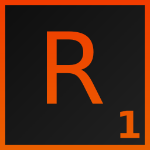
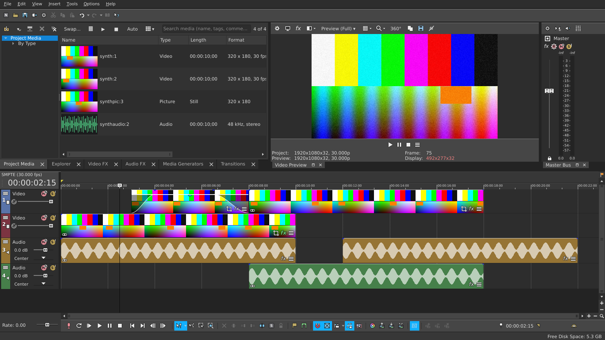
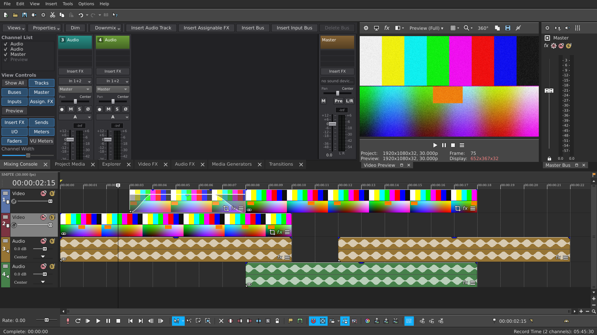
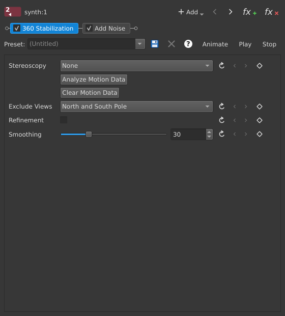

# Reno

A video editor that works like VEGAS Pro 18. It opens and saves `.veg` projects, has the same menus and shortcuts, and
runs the same plug-ins: OpenFX video effects and VST2, VST3 and DirectX audio effects. Written in C++17 with Qt 6,
FFmpeg and Vulkan, for Windows, Linux and macOS, with newer builds for Windows 7, FreeBSD, Android and iOS.

Reno is not affiliated with VEGAS, MAGIX or Sony, and contains no VEGAS code or files. It has its own versions of all
of VEGAS Pro 18's video effects, transitions and generators, made to match VEGAS's output. It uses them even when VEGAS
is installed; VEGAS's own effect plug-ins are loaded only if Preferences > Video says to.

## Screenshots

| Audio Mixing layout | Video event effects |
|---|---|
|  |  |

The screenshots use generated test media; `tests/ui/vegasshot_test.cpp` makes them.

## Features

- Opens, edits and saves `.veg` projects, keeping the settings it doesn't understand
- Video and audio tracks, buses, envelopes, transitions, compositing, Pan/Crop, Track Motion and nested projects
- OpenFX, VST2 (including 32-bit), VST3 and DirectX plug-in hosts
- Built-in versions of VEGAS's video effects, transitions and generators, rendered on the GPU with Vulkan
- Time stretch and pitch shift, 5.1 audio, loudness meters and recording
- Runs VEGAS scripts (`.cs`, `.js`, `.vb`)
- Opens and renders every audio and video format FFmpeg supports, from the editor or the command line (`reno_cli`)

## Downloads

Builds are on the [Releases](../../releases) page. Every push to `main` updates the "Nightly build" prerelease.
Versioned releases come from pushing a `v*` tag (for example `v0.1.0`), or from Actions > Build > Run workflow with a
version filled in.

| File | System | Notes |
|---|---|---|
| `reno-windows-x64.zip` | Windows 10 and 11, 64-bit | |
| `reno-linux-x64.tar.gz` | Linux, x86-64 | |
| `reno-macos-arm64.zip` | macOS 11 and later, Apple Silicon | not yet tried on a Mac |
| `reno-macos-x64.zip` | macOS 11 and later, Intel | not yet tried on a Mac |
| `reno-windows7-x64.zip` | Windows 7 SP1 and 8.1, 64-bit | not yet tried |
| `reno-freebsd-x64.tar.gz` | FreeBSD 14, amd64 | not yet tried |
| `reno-android-arm64.apk` | Android 9 and later, 64-bit ARM | not yet tried |
| `reno-ios-unsigned.ipa` | iPhone and iPad, iOS 16 and later | not yet tried |

Things to know for each system:

- **macOS:** Reno.app is not signed with a developer account, so macOS refuses it at first. Right-click it and choose
  Open, or run `xattr -dr com.apple.quarantine Reno.app`. Effects use Vulkan through MoltenVK when it is installed
  (`brew install molten-vk`), and the CPU otherwise.
- **Windows 7:** Qt's DLLs are swapped for patched ones that run there
  ([qt6windows7](https://github.com/crystalidea/qt6windows7)). FFmpeg needs the Universal C Runtime (Windows Update
  KB2999226), and GPU effects need a graphics driver with Vulkan for Windows 7.
- **FreeBSD:** install Qt and FFmpeg from packages first:
  `pkg install qt6-base qt6-multimedia ffmpeg vulkan-loader`.
- **Android:** each build is signed with a key of its own, so uninstall the older one before installing a newer one.
- **iOS:** the app is not signed. Sign it with your own Apple ID (for example with Sideloadly or AltStore) to install it.

32-bit plug-ins and VEGAS's DirectX audio plug-ins work on Windows only. On Android and iOS Reno has its own effects
only (plug-ins are desktop programs and can't load there), no `reno_cli`, and FFmpeg's own encoders instead of x264 and
x265.

## Formats and codecs

The Windows and Linux builds come with FFmpeg's full 8.1 build, so Reno opens and renders everything FFmpeg supports.
The common ones:

- **Video:** H.264 / AVC, H.265 / HEVC, AV1, VP8, VP9, ProRes, DNxHD / DNxHR, CineForm, MPEG-2, MPEG-4 Part 2 (Xvid,
  DivX), Theora, MJPEG, FFV1, HuffYUV, UT Video, QuickTime Animation, uncompressed RGB / YUV, WMV, VC-1
- **Audio:** AAC, MP3, Opus, Vorbis, FLAC, ALAC, WAV / PCM (16, 24, 32-bit and float), AIFF, AC-3, E-AC-3, DTS, WMA,
  TrueHD, WavPack, Monkey's Audio
- **Containers:** MP4, MOV, MKV, WebM, AVI, MXF, MPEG-TS, MPEG-PS, M4A, OGG, FLV, WMV / ASF, GIF, and image sequences
  (PNG, JPEG, TIFF, EXR, DPX, BMP)

Hardware encoding uses NVENC, Quick Sync or AMF when the graphics card has it.

## Using Reno

Start Reno (`reno.exe` on Windows, `Reno.app` on macOS, `reno` elsewhere). The first start looks for plug-ins and tests
each one in its own process, so a plug-in that crashes can't take Reno down with it.

Keep backups of your projects. Reno saves the previous file as `<name>.veg.bak`, but its `.veg` output isn't tested
against every VEGAS version. Known gaps are listed in [docs/NOTES.md](docs/NOTES.md).

### Phones and tablets

On Android and iOS Reno starts with a touch interface. The playhead stays in the middle of the timeline and the
tracks move under it:

- Drag across the tracks to move through the project, and flick to keep going. Pinch with two fingers to zoom.
- Tap a clip to select it, and tap an empty place to clear the selection. A selected clip has handles at its ends:
  drag them to trim it. Drag a selected clip to move it, or hold a finger on any clip to pick it up. Edges snap to the
  playhead, markers and other clips.
- The tool bar at the bottom follows the selection: with nothing selected it adds media, sound, text, effects and
  tracks; with clips selected it splits them, changes their speed, volume and fades, and adds effects and
  transitions. Tap a track's name at the left for its settings.
- Tap the picture to play or pause. Export renders MP4 video or the sound alone, with Render As for every other
  format. The menu at the top left opens and saves projects, and lists every command of the desktop menus. It also
  switches to the desktop interface.

### Command line

`reno_cli` renders projects without opening the editor:

    reno_cli project.veg
    reno_cli project.veg -o out.mp4 -t "MAGIX AVC/AAC MP4/Internet HD 1080p 29.97 fps" -y
    reno_cli project.veg --video-codec libx265 --audio-codec flac -o out.mkv
    reno_cli --help

`-t` picks one of Render As's templates. `--video-codec` and `--audio-codec` take any FFmpeg encoder by name
(`ffmpeg -encoders` lists them).

It can also measure the built-in effects on your processor and graphics card, in milliseconds per frame:

    reno_cli fxbench --both --size 1920x1080
    reno_cli gpupick --again

`gpupick` shows whether Reno uses the CPU or the GPU for each effect. Reno measures this once per graphics card by
itself; `--again` measures it anew.

## Building

Every build uses Qt 6.8.3 with Multimedia and FFmpeg 8.1. More configurations are in `CMakePresets.json`. One way to
get Qt is [aqtinstall](https://github.com/miurahr/aqtinstall) (`pip install aqtinstall`), as in the commands below.

### Windows

You need Visual Studio 2022 with the C++ workload and its "C++ Clang tools for Windows" component, and Qt 6.8.3 for
`msvc2022_64`. Reno is built with clang-cl; `build_msvc.bat msvc` uses MSVC instead. Get FFmpeg into `deps\ffmpeg`
with:

    powershell -ExecutionPolicy Bypass -File tools\get_ffmpeg.ps1

Then run `build_msvc.bat` (the output goes to `build\out\`), or open `Reno.sln` and build x64 Release. Qt is expected in
`C:\Qt\6.8.3\msvc2022_64`; set `RENO_QT_DIR` to use another folder, and `RENO_FFMPEG_DIR` for another FFmpeg.

### Windows 7

Build as on Windows with `build_msvc.bat win7` (the output goes to `build\out-win7\`). Alternatively, build the
`windows7-clangcl-release` preset and then run
`powershell -ExecutionPolicy Bypass -File tools\use_qt_win7.ps1 <the folder with reno.exe>`.

Either way, Reno is compiled to use only functions Windows 7 has, and the script swaps Qt's DLLs for the patched ones
from [qt6windows7](https://github.com/crystalidea/qt6windows7); it needs 7-Zip. Windows XP isn't possible: Qt 6,
FFmpeg, Vulkan and Visual Studio's compilers no longer support it.

### Linux

    sudo apt install cmake ninja-build g++ libgl-dev
    tools/get_ffmpeg.sh
    aqt install-qt linux desktop 6.8.3 linux_gcc_64 -m qtmultimedia -O ~/Qt
    cmake --preset linux-release
    cmake --build --preset linux-release

### macOS

    brew install cmake ninja ffmpeg
    aqt install-qt mac desktop 6.8.3 clang_64 -m qtmultimedia -O ~/Qt
    cmake -S . -B build -G Ninja -DCMAKE_PREFIX_PATH=~/Qt/6.8.3/macos -DRENO_FFMPEG_DIR="$(brew --prefix)"
    cmake --build build
    open build/bin/Reno.app

The build is for the Mac's own processor (Apple Silicon or Intel). To make a Reno.app you can give to someone else,
run:

    macdeployqt build/bin/Reno.app -executable=build/bin/Reno.app/Contents/MacOS/reno_cli
    codesign --force --deep --sign - build/bin/Reno.app

### FreeBSD

    pkg install cmake ninja pkgconf qt6-base qt6-multimedia ffmpeg vulkan-loader
    cmake --preset freebsd-release
    cmake --build --preset freebsd-release

### Android

You need the Android SDK, NDK 26.1.10909125 and JDK 17, plus Qt 6.8.3 for Android and for your computer. Qt for
Android 6.7 and later is listed under the `all_os` host:

    aqt install-qt all_os android 6.8.3 android_arm64_v8a -m qtmultimedia -O ~/Qt
    aqt install-qt linux desktop 6.8.3 linux_gcc_64 -O ~/Qt

Build FFmpeg for Android, then Reno's APK:

    export ANDROID_SDK_ROOT=~/Android/Sdk ANDROID_NDK_ROOT=~/Android/Sdk/ndk/26.1.10909125
    tools/build_ffmpeg_android.sh
    ~/Qt/6.8.3/android_arm64_v8a/bin/qt-cmake -S . -B build/android -G Ninja -DCMAKE_BUILD_TYPE=Release \
        -DQT_HOST_PATH=~/Qt/6.8.3/gcc_64 -DANDROID_SDK_ROOT=$ANDROID_SDK_ROOT -DANDROID_NDK_ROOT=$ANDROID_NDK_ROOT \
        -DRENO_FFMPEG_DIR=$PWD/deps/ffmpeg-android
    cmake --build build/android --target apk

The APK is under `build/android/android-build/build/outputs/apk/`. Sign it with `apksigner` (from the SDK's
build-tools) to install it. Qt Creator can also open the project and run it on a connected device.

### iOS

On a Mac with Xcode:

    aqt install-qt mac ios 6.8.3 ios -m qtmultimedia --autodesktop -O ~/Qt
    tools/build_ffmpeg_ios.sh
    ~/Qt/6.8.3/ios/bin/qt-cmake -S . -B build/ios -G Xcode -DQT_HOST_PATH=~/Qt/6.8.3/macos -DRENO_FFMPEG_DIR=$PWD/deps/ffmpeg-ios
    open build/ios/Reno.xcodeproj

The app is built for iOS 16 and later. In Xcode choose your team under Signing & Capabilities for the `reno` target,
then run it on your iPhone or iPad.

## Tests

Tests are in `tests/`, one program per `.cpp` file. Each file's header says how to build and run it. Tests that need
real VEGAS projects or VEGAS output read their location from environment variables (`RENO_SAMPLES` and others; see
[docs/NOTES.md](docs/NOTES.md)), and skip when those aren't set.

The tools used to record VEGAS's output and compare Reno against it (VEGAS capture scripts and comparison scripts) are
development tools and are kept out of the repository (see `.gitignore`).

## Third-party code

- `third_party/openfx`: OpenFX headers (BSD 3-clause)
- `third_party/vst2`: a clean-room VST2 header (BSD 3-clause)
- `third_party/vulkan`: Vulkan headers (Apache-2.0 or MIT)
- `third_party/rmath`: notices for the maths routines in `src/core/rmath.h`, which follow ARM's optimized-routines (MIT)
  and Sun's fdlibm

## License

No license yet; all rights reserved.
