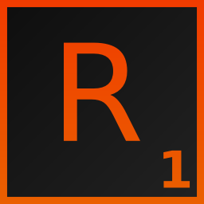

# Reno

A video editor that works like VEGAS Pro 18. It opens and saves `.veg` projects, uses the same menus and shortcuts,
and runs the same plug-ins (OpenFX video effects, VST2/VST3/DirectX audio effects). C++17, Qt 6 and FFmpeg.
Windows first; most of it also runs on Linux.

Not affiliated with VEGAS, MAGIX or Sony. No VEGAS code or files are included. To use VEGAS's own effects you need
VEGAS Pro installed; without it Reno uses its own versions of the common ones.

## Features

- Opens, edits and saves `.veg` projects, keeping settings it doesn't understand
- Video and audio tracks, buses, envelopes, transitions, compositing, Pan/Crop, Track Motion, nested projects
- OpenFX, VST2, VST3 and DirectX plug-in hosts (32-bit VST2 too)
- Built-in versions of VEGAS's video effects, transitions and generators, with Vulkan GPU rendering
- Time stretch and pitch shift, 5.1 audio, loudness meters, recording
- Runs VEGAS scripts (`.cs`, `.js`, `.vb`)
- Opens and renders every audio and video format FFmpeg supports (see below), from the editor or the command line (`reno_cli`)

## Formats and codecs

The Windows and Linux builds come with FFmpeg's full build (8.1), so Reno opens and renders everything FFmpeg
supports. The common ones:

- **Video:** H.264 / AVC, H.265 / HEVC, AV1, VP8, VP9, ProRes, DNxHD / DNxHR, CineForm, MPEG-2, MPEG-4 Part 2 (Xvid,
  DivX), Theora, MJPEG, FFV1, HuffYUV, UT Video, QuickTime Animation, uncompressed RGB / YUV, WMV, VC-1
- **Audio:** AAC, MP3, Opus, Vorbis, FLAC, ALAC, WAV / PCM (16, 24, 32-bit and float), AIFF, AC-3, E-AC-3, DTS, WMA,
  TrueHD, WavPack, Monkey's Audio
- **Containers:** MP4, MOV, MKV, WebM, AVI, MXF, MPEG-TS, MPEG-PS, M4A, OGG, FLV, WMV / ASF, GIF, image sequences
  (PNG, JPEG, TIFF, EXR, DPX, BMP)

Hardware encoding uses NVENC, Quick Sync or AMF where the graphics card has it. Render As has the usual templates, and
`reno_cli` takes any FFmpeg encoder by name: `reno_cli project.veg --video-codec libx265 --audio-codec flac -o out.mkv`
(`ffmpeg -encoders` lists them).

Keep backups: Reno saves the previous file as `<name>.veg.bak`, but its `.veg` output isn't tested against every
VEGAS version. Known gaps are listed in [docs/NOTES.md](docs/NOTES.md).

## Downloads

Builds are on the [Releases](../../releases) page. Every push to `main` updates the "Nightly build" prerelease;
versioned releases come from pushing a `v*` tag (for example `v0.1.0`) or from Actions > Build > Run workflow with a
version filled in. The macOS build is new and untested.

## Building on Windows

You need Visual Studio 2022 (C++ workload) and Qt 6.8.3 for `msvc2022_64` with Multimedia. Get a full FFmpeg build
(all codecs) into `deps\ffmpeg` with:

    powershell -ExecutionPolicy Bypass -File tools\get_ffmpeg.ps1

Then either run `build_msvc.bat` (output in `build\out\`) or open `Reno.sln` and build x64 Release.
Qt is expected in `C:\Qt\6.8.3\msvc2022_64`; set `RENO_QT_DIR` (and `RENO_FFMPEG_DIR` for another FFmpeg) to use
other folders.

## Building on Linux

    sudo apt install cmake ninja-build g++ libgl-dev
    tools/get_ffmpeg.sh
    pip install aqtinstall
    aqt install-qt linux desktop 6.8.3 linux_gcc_64 -m qtmultimedia -O ~/Qt
    cmake --preset linux-release
    cmake --build --preset linux-release

Other presets are in `CMakePresets.json`.

## Usage

Run `reno.exe`. The first start scans for plug-ins; each one is tested in its own process, so a crashing plug-in
won't take Reno down.

Rendering from the command line:

    reno_cli project.veg
    reno_cli project.veg -o out.mp4 -t "MAGIX AVC/AAC MP4/Internet HD 1080p 29.97 fps" -y
    reno_cli --help

## Tests

Tests are in `tests/`, one program per `.cpp`; each file's header says how to build and run it. Tests that need
real VEGAS projects or VEGAS output read their location from environment variables (`RENO_SAMPLES` and others, see
[docs/NOTES.md](docs/NOTES.md)) and skip when they aren't set.

`tools/scripts/` has VEGAS scripts that record VEGAS's output so Reno can be compared against it, including
`Reno Plugin Fuzz.cs`, which tests every installed effect (compare with `tools/fuzz_compare.py`).

## Third-party code

- `third_party/openfx` - OpenFX headers (BSD 3-clause)
- `third_party/vst2` - clean-room VST2 header (BSD 3-clause)
- `third_party/vulkan` - Vulkan headers (Apache-2.0 or MIT)

## License

No license yet; all rights reserved.
